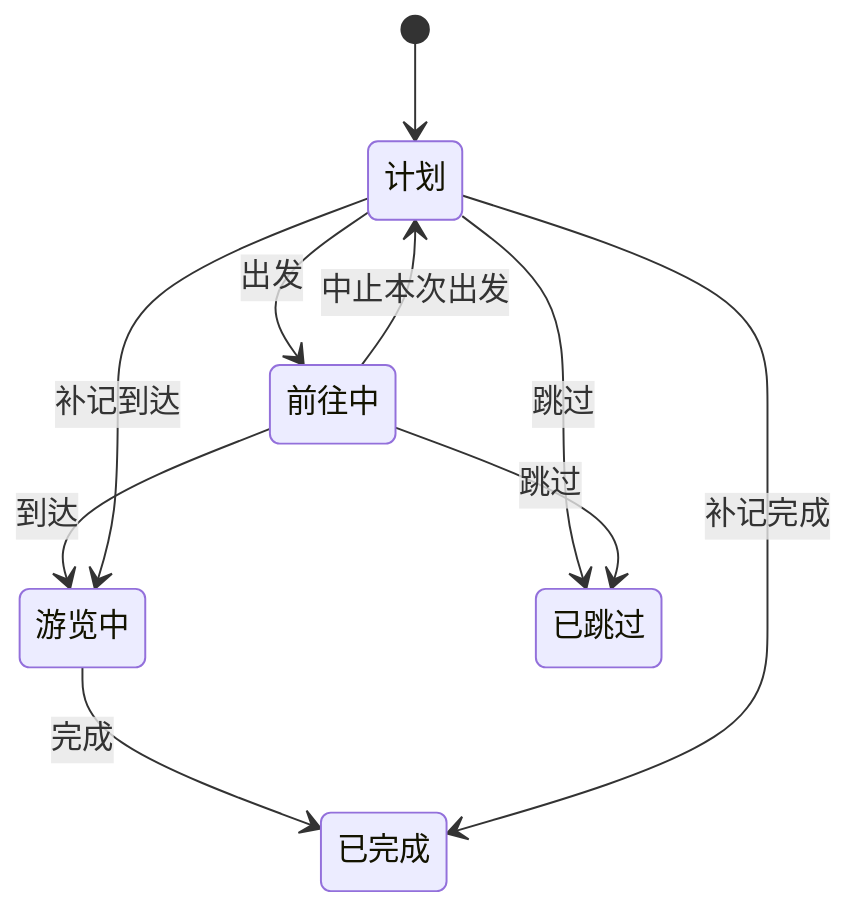

# 计划与进度：三态转换与调度逻辑规范

> v2.2 · 2026-10-01。统一状态转换、真实时间、路线预测和跨日规则，补充静态方案自动分天及用户主动将后续安排改到白天。
> 本文替代 v1.7 中“游览结束作为出发基准”“实际完成按 24 小时截断”等旧规则。

## 1. 状态与执行事实

界面仍使用三态，进行中内部区分前往中和游览中；跳过是额外终态。

| 状态 | 标识 | 含义 |
| --- | --- | --- |
| 计划 | planned | 尚未开始执行 |
| 进行中：前往中 | en_route | 已记录出发，尚未记录到达 |
| 进行中：游览中 | visiting | 已记录到达，尚未记录完成 |
| 已完成 | completed | 已记录真实完成 |
| 已跳过 | skipped | 用户主动跳过，不占排期 |

| 当前状态 | 出发 | 到达 | 完成 | 跳过 | 中止 |
| --- | --- | --- | --- | --- | --- |
| 计划 | 前往中 | 游览中，可补记 | 已完成，可补记 | 已跳过 | 禁止 |
| 前往中 | 禁止 | 游览中 | 禁止，先到达或纠正 | 已跳过 | 计划 |
| 游览中 | 禁止 | 禁止 | 已完成 | 禁止 | 禁止，结束游览用完成，误操作用纠正 |
| 已完成 / 已跳过 | 禁止 | 禁止 | 禁止 | 禁止 | 禁止 |

- **P1 保护事实**：完成、跳过为终态；误操作通过独立纠正事件修正，原记录保留，普通编辑和恢复计划版本不能撤回执行事实。
- **P2 单一进行中**：同一用户的全部日期计划合计至多一个前往中或游览中地点。出发、到达及纠正为进行中都执行此检查，跨午夜也不例外。其他用户独立。
- **P3 到访独立**：地点标识 `placeId` 可重复，节点标识 `stopId` 必须唯一。同一地点每次到访有独立时间、路线与状态；新增回访不重置已完成、已跳过或正在进行的旧到访。终态保护针对那次到访，不禁止将来再次去该地点。名称式 Agent 进度优先匹配对应进行中状态或下一次待进行到访，改时间/时长遇到多个待进行匹配时不猜测目标。
- 重复到访在地点名下标明“第 N 次到访”，依据到访节点区分。第一回 A 已完成时，第二回 A 可以出发；第一回仍在前往或游览时，第二回受 P2 约束。禁用出发旁必须显示具体进行中的地点与状态，并提供查看该到访的入口，不仅使用鼠标悬停提示；处理完成后解除限制，不自动结束任何到访。
- 状态由有效执行事件重放得到。路线预测、计划时段到期、地图打开、定位接近目的地都不能自动变成到达或完成。
- 中止表示结束本次前往尝试并回到计划；游览中正常离开应记录完成。

## 2. 三类时间分开

| 时间 | 用途 | 规则 |
| --- | --- | --- |
| 计划窗口 | 表达安排与计划停留时长 | 可编辑、可顺延；不冒充实际到达 |
| 预计窗口 | 当前路线、实际进度推导的预测 | 由视图计算，不持久化为实际事实 |
| 实际时间 | 真实出发、到达、完成事件 | 按实际时区与日期记录；缺少到达时保持未知 |

- `plannedTravelStartMinutes` 表示前往本站的计划出发；`travelStartMinutes` 表示本次真实出发。`departureMinutes` / `plannedDepartureMinutes` 表示离开本站，不能用来判断“前往本站”是否迟到。
- `forecastStartMinutes` / `forecastEndMinutes` 是展示推导值；`actualArrivalMinutes` / `actualCompletionMinutes` 由有效事件推导。
- 补记入口允许填写实际发生时间，按计划时区解释，拒绝无效或未来输入。直接完成但没有到达记录时，只记录完成这个时刻，实际到达和实际停留时长保持未知。
- 已记录到达后，完成不能早于到达；已记录出发后，到达不能早于出发。禁止把错误时间静默夹到合法边界。

## 3. 时间调度

### T1：区间与交通可达性

相邻站点的可执行窗口应满足：

`下一站开始 ≥ 上一站结束 + 已知交通耗时 + 路线缓冲`

- 只使用对应当前相邻起终点的有效路线段。秒口径优先，缓冲另计。
- 前往中尚无实际到达时，只按真实出发时刻占位；路线 ETA 在预测视图中推算游览结束及后续可达窗口。
- 交通未知时标为待估，不填 0 分钟或固定 30 分钟。系统能保证游览窗口不重叠，但不能把未知交通的可达性说成已核实。
- 编辑器按所选交通方式查询当前相邻地点的道路时间，保留游览时长及更大间隔；固定时段与已知交通冲突时要求调整后保存。失败、跨城和缺坐标保持待估，保存标明未知段。此查询不记录出发或到达事实；行前仍需按当前位置重新估算。
- 可移动的计划站点自动后移，保留计划停留时长；已完成、进行中、固定时段不可被静默改写。事实与固定约束之间的冲突标为需核对。
- 普通时间选择表达偏好，不自动添加固定时段标记。编辑开始/停留时先推荐满足前站结束及已知路线缓冲的值，并顺延可移动后续节点；固定节点前空间有限时可回填更早的本次开始或更短的本次停留，界面说明改动后由用户保存。已记录事实与其他固定节点保持原值，无足够可用窗口时明确报冲突。跨日偏移与时分分别保留；自动回填计划值不会生成出发、到达或完成事实。

### T2：计划时长与实际时长

- 出发、到达和冲突消解保持后续地点的计划停留时长。
- 到达时按实际到达加计划时长得到预计结束。
- 完成时按真实完成时刻记账，实际停留可以短于或长于计划；实际到达未知时不计算实际停留。

### T3 / T4：提前不自动前移，延后只传播新增延误

出发基准依次取：

1. 明确的前往本站计划出发时间。
2. 本站计划到达/开始减原计划相邻路线耗时。
3. 无原路线时，使用本次有效路线估算倒推出发；仍未知时以计划开始作为最晚出发参考，并保留交通待估提示。

绝不使用本站游览结束作为出发基准。

- 出发延误 `D = max(0, 实际出发 - 出发基准)`，向同日后续可移动计划站点传播。中止后再次出发时扣除此前已经传播的延误，只增加新延误。
- 到达导致的总延误要扣除本次出发已经传播的 `D`，只顺延新增部分。路线预测造成的预计后移不作为已经传播的实际延误，不能在真实到达时重复记账。
- 完成只传播相对当前窗口新增的延误。提前到达、提前完成不自动前移后续计划。
- 越过已完成、进行中和锁定站时保留该站，再继续处理后续计划；残余冲突另行核对。

例：计划 10:00 到达，路程 30 分钟，计划 09:30 出发。实际 10:20 出发晚 50 分钟；10:50 到达时总延误仍为 50 分钟，后续不会再顺延一次 50 分钟。

### T5：跳过

跳过不占时间、不参加排期；后续计划不自动提前。历史中保留跳过记录，误点通过纠正恢复。

### T6：乱序与中止

- 允许任选计划地点出发，但必须先处理当前进行中的地点。
- 有效执行尝试按触发顺序占位，未开始地点按原相对顺序跟随。原相对顺序由执行前顺序标记保存。
- 旧数据缺少顺序标记时，首次操作按当前计划顺序补齐；没有原始证据时不猜测历史顺序。
- 中止或纠正回计划后，旧出发尝试退出执行排序，该地点回到待执行队列的原相对位置。
- 中止不抹去出发事实，也不自动把已经传播的延误拉回过去；恢复顺序后再次消解冲突。
- 若本次出发把后续站点迁入其他日期，服务保留迁移的独立 stopId 关联。中止后列出仍待执行且存在白天时段之外安排的受影响日期，可打开“移到白天”预览；取消不改任何日期或事实，确认沿用白天改期的版本与预约保护。已经调整为白天、完成或删除的站点不重复提示；新一次同站出发保留尚未处理的关联。旧记录缺少关联时仍使用凌晨站点的“移到白天”入口，不按同名地点猜测历史迁移。
- 普通级联保留站间间隔；冲突消解可收紧空闲间隔，但已知交通和缓冲仍必须保留。
- 待执行的清晨安排（09:00前）“移到白天”优先预览所属日期的白天时段；不因开始时间在06:00之后额外推进一天。若当天白天已过或约束排不下，服务再查找可用的后续日期，明确展示后确认。

### T7：跨日归属

- 只有尚未开始且起始被实际顺延推到 24:00 之后的计划站点迁入对应日期计划，分钟按日期归一化。
- 次日无计划时创建；已有计划时按顺延时刻合并并消解冲突。不能覆盖已有执行事实。
- 前往中、游览中和已完成站点及其事实留在原日期计划。
- 纯路线预测跨午夜仅显示预计次日窗口，不因预测而迁移执行事实。

用户明确选择“移到白天”属于主动编辑：从选定的独立到访开始，只调整没有任何执行记录、未跳过且未锁时／预约的后续站点。先展示具体日期与时间，保留停留时长，接在目标日已有安排之后；遵守已录入开放区间与 09:00–20:00 白天窗口，今天的开始值不得落在过去，当前日期排不下则继续找后续日期。未知开放和交通保持待核对，不写成已核实可达。原进行中、完成、中止或纠正历史及固定预约留在原处，费用退改条件不能被绕过。确认重算并核对源日与所有查找日期的存在性和版本，再整批提交；取消或冲突不写半份结果。这不是由路线预测自动迁移，亦不产生执行事实。

静态方案（kind=scheme）不承载执行事实，其设计时间跨日时立即补齐天数：次日开始的地点移至实际天数并归一化时间，跨午夜结束的同一次游览保留原节点，后续天显示只读延续提示。刚好午夜结束不增加一天。编辑、保存、Agent 生成及旧方案读取一致；延续提示不生成另一站或实际到访。此规则不改变日计划 T7 的迁移条件。

### T8：跨午夜延续与历史保存

- 当天正常记录；跨午夜正在执行的地点仍在原计划继续记录。
- 未开始、原安排本身跨午夜的地点仅在原跨日窗口内允许延续。
- 前往中、游览中的原计划不会因超过预计结束或超过 24 小时而清理；超时提示核对，直到用户完成、中止或纠正。
- 页面可见性、操作校验、服务端清理遵循同一规则；首页优先展示未结束的跨日地点。
- 普通过期未执行安排仍按现有归档规则保存为可复用方案。
- 普通过期原日计划、完整执行链和已有内容快照转入「往日记录」，旧进行中收尾后同样保留。按原计划当地日期过去 30 天内可补记到访或明确纠正，第 31 天起只读，主动删除前可查看。
- 历史补记只记完成/跳过，可将实际到达和完成原子提交；历史纠正只设未完成/已完成/已跳过，保留原事件。不会产生实时进行中、导航、T7 迁移或对其他节点的时间传播；当天执行仍遵循原三态规则。

### T9：24 小时仅约束计划窗口

- 计划预测游览时长最多 24 小时。
- 真实完成时间不截断；满 24 小时不会自动生成完成事实。
- 超时访问保持进行中并提示核对，不阻止合法的真实结束记录。

### T10：路线 ETA

- 出发时按选定交通方式、当前位置与本站终点规划路线。普通入口可打开地图；伴途随行保持同页，不另建三态。
- 定位失败时可重试或由用户明确选择“我已出发，先记录”，降级请求跳过路线估算，不能拿上一站包装成当前位置。路线失败保持预计待定；具名上一已确认地点只用于明确标来源的预览。
- 本次出发的有效路线估算优先于旧路线段；旧估算不能掩盖本次失败。
- 预测窗口参与后续可达性展示，实际到达仍由到达事件确定。中止清除本次路线估算。
- 随行中道路刷新只改短期视图，不改出发事实及已传播延误；临时建议只编辑尚未开始的安排，并经预览、用户确认及版本/事实检查。

## 4. 页面与数据一致性

- 主列表按已完成 → 进行中 → 计划分组，组内按实际/预计时间排序；显示排序不得改写排期队列。
- 当有另一个进行中地点时，计划地点的出发入口禁用，服务端同时强制检查。
- 计划地点提供补记入口；已执行地点和进度历史提供纠正入口。
- 超过预计时段显示实际进度仍保留，继续提供合法的到达、完成、中止或纠正动作。
- 预测字段不保存进计划或复用方案；复用方案清除上次执行顺序、延误计数、真实出发与实时路线估算。
- 编辑进行中的计划保留已传播延误，避免编辑后到达再次顺延。

## 5. 实现与回归

- 状态机、时间对齐与实际冲突消解：`src/domain/execution.ts`。
- 有效尝试、出发基准、交通耗时与预测视图：`src/domain/execution-schedule.ts`。
- 全用户单一进行中、跨日保留、清理与计划视图：`src/services/plan-library.ts`。
- 展示与操作：`public/views/today.js`、`public/views/home.js`、`public/lib/components.js`、`public/lib/itinerary-timing.js`、`public/lib/plan-execution-window.js`。
- 补记入口：`public/lib/progress-backfill.js`。
- 专项回归：`tests/execution-design.test.ts`、`tests/plan-schedule-alignment.test.ts`、`tests/frontend-plan-execution.test.ts`、`tests/itinerary-timing.test.ts`。
- 完整检查：`npm run check`。浏览器验证：`node scripts/verify-ui-cards.mjs`。
